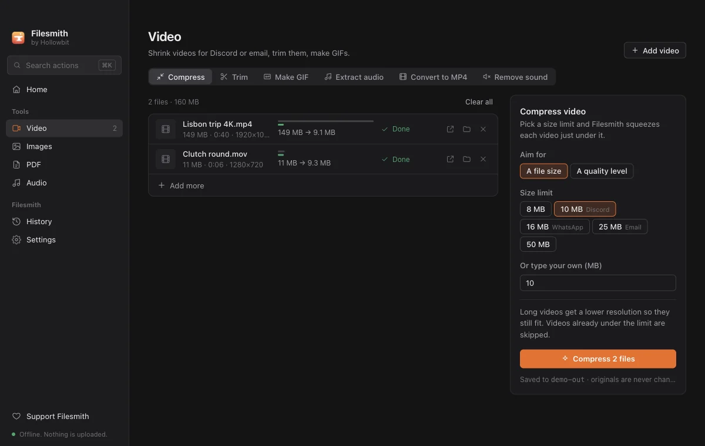

<p align="center">
  <a href="https://hollowbit.dev/fileshaper/"></a>
</p>

<h1 align="center">Fileshaper</h1>

<p align="center"><b>Stop uploading your files to sketchy websites.</b></p>
<p align="center">Compress videos for Discord, turn iPhone photos into JPGs, and merge and sign PDFs on your own computer. No limits, no watermarks, no account, no uploads.</p>

<p align="center">
  <a href="https://github.com/hollowbit-dev/fileshaper/releases/latest"></a>
  
  
  <a href="LICENSE"></a>
</p>

<p align="center">
  <a href="https://hollowbit.dev/fileshaper/download.html"></a>
  <a href="https://github.com/hollowbit-dev/fileshaper/actions/workflows/test.yml"></a>
</p>

<p align="center"></p>

## What it does

| Video | Images | PDF | Audio |
|---|---|---|---|
| Compress to a size (8/10/16/25/50 MB or custom) | HEIC to JPG / PNG / WebP | Sign (draw or type) | Convert MP3, M4A, WAV, FLAC, OGG |
| Compress by quality | Resize (longest side or %) | Fill text and dates | Trim with preview |
| Trim with live preview | Compress | Merge | Even out volume (−14 LUFS) |
| Video to GIF | Images to PDF | Split (every page / ranges / pick pages) | |
| Extract audio (MP3) | | Organize: reorder, rotate, delete pages | |
| Convert to MP4 | | Compress (light or strong) | |
| Remove sound | | | |

Originals are never changed. New files are saved next to the original, or in a folder you pick.

## Install

Get the installer from the [website](https://hollowbit.dev/fileshaper/download.html) or the [latest release](https://github.com/hollowbit-dev/fileshaper/releases/latest).

- **Mac:** open the .dmg and drag Fileshaper to Applications. The first time, right-click it and choose **Open**, because the app isn't signed yet.
- **Windows:** run the installer. If SmartScreen appears, click **More info**, then **Run anyway**.

With Homebrew:

```sh
brew tap hollowbit-dev/tap
brew trust hollowbit-dev/tap
brew install --cask fileshaper
```

Windows signing is being set up through SignPath Foundation's free open-source programme. See [SIGNING.md](SIGNING.md).

## Privacy

No network requests except an optional daily update check against GitHub (Settings → Check for updates).

## Run from source

You need Node.js 20+.

```bash
npm install
npm start                 # opens the app
bash test/make-media.sh   # sample files for the tests (once)
npm test                  # end-to-end checks against the real app
npm run dist:mac          # Mac installers in dist/
npm run dist:win          # Windows installer (builds fine on a Mac)
npm run site              # rebuilds the website in docs/
```

## How it's built

- **Electron** app shell. `src/main.js` serves app files and the user's files over a private `fileshaper://` scheme with HTTP range support, so video previews can seek.
- **FFmpeg** (bundled) for video, audio and image work. Target-size compression is two-pass x264 with the bitrate worked out from the duration. Resolution drops automatically when the budget is tight.
- **heic-convert** decodes iPhone photos, which FFmpeg 6 can't read reliably.
- **pdf-lib** edits PDFs and **PDF.js** draws pages for previews, page thumbnails, signing and strong compression.

```
src/main.js            window, fileshaper:// protocol, job runner (video/image/audio)
src/ffmpeg.js          probe + run with progress
src/store.js           settings, history, totals
src/preload.js         the only bridge between the window and the computer
src/renderer/          UI: app.js (tools), pdf-tools.js (PDF), ui.js, app.css, config.js
docs/                  the website (GitHub Pages)
test/e2e.mjs           end-to-end tests (Playwright driving the real app)
test/marketing-shots.mjs  regenerates the website screenshots
```

## More free apps from Hollowbit

- **[Melodyshaper](https://hollowbit.dev/melodyshaper/)**: hum a tune, make a song
- **[Clipshaper](https://hollowbit.dev/clipshaper/)**: long videos to short clips
- **[Captionshaper](https://hollowbit.dev/captionshaper/)**: offline auto subtitles
- **[Lightshaper](https://hollowbit.dev/lightshaper/)**: free photo editor
- **[Writeshaper](https://hollowbit.dev/writeshaper/)**: offline writing assistant
- **[Moveshaper](https://hollowbit.dev/moveshaper/)**: move to a new computer
- **[Diskshaper](https://hollowbit.dev/diskshaper/)**: clean up storage
- **[Startshaper](https://hollowbit.dev/startshaper/)**: find out why your PC is slow
- **[Fuseduo](https://fuseduo.com/)**: automate your Mac apps

## Licence

GPL-3.0-or-later (see [LICENSE](LICENSE)). Fileshaper bundles FFmpeg built with x264 (GPL). See [THIRD_PARTY_NOTICES.md](THIRD_PARTY_NOTICES.md) for every component and its licence.

---

<p align="center"><sub>Made by <a href="https://hollowbit.dev">Hollowbit Studio</a>. If Fileshaper helped you, a ⭐ helps other people find it.</sub></p>
